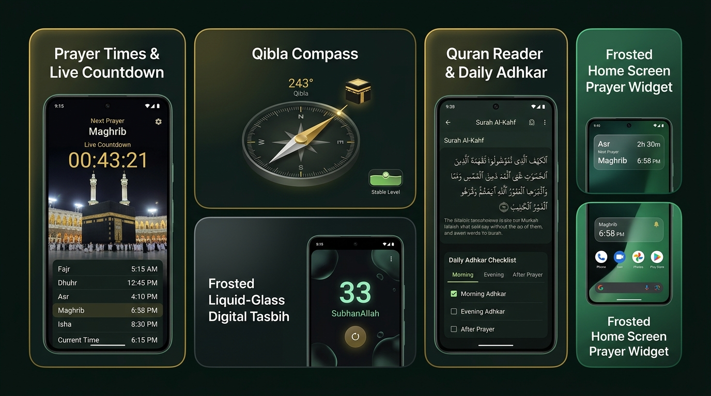

  

<h1 align="center">صلاتي وأذكاري — Salati &amp; Adhkar</h1>

  
  
  
  
  

  <strong>مواقيت الصلاة والأذكار، بتجربة روحانية متكاملة. تصميم زجاجي هادئ، دقة عالية، وبدون أي إعلانات.</strong>

  تطبيق <strong>صلاتي وأذكاري</strong> يجمع بين مواقيت الصلاة الدقيقة، الأذان الذكي، بوصلة القبلة الاحترافية، الورد القرآني والأذكار اليومية، والمسبحة الزجاجية التفاعلية في واجهة <strong>Material 3</strong> عصرية ومريحة للعين.

  

---

## ✨ أبرز المزايا (Features)

| الميزة | التفاصيل |
| :--- | :--- |
| 🕌 **مواقيت الصلاة والعد التنازلي** | حساب دقيق لمواقيت الصلوات الخمس مع عدّاد تنازلي مباشر للصلاة القادمة، وخيار تفعيل أو إخفاء إشعار العد التنازلي الدائم من الإعدادات. |
| 🔕 **أذان ذكي يحترم وضع هاتفك** | يصدح بصوت الأذان الكامل في الوضع العام، ويتحوّل تلقائياً إلى إشعار صامت بدون صوت أو إزعاج عند تفعيل وضع **الصامت** أو **الهزاز** أو **عدم الإزعاج (DND)**. |
| 🔄 **مزامنة خلفية ذكية** | جدولة تلقائية عبر **WorkManager** لتحديث مواقيت الصلاة عند توفر الإنترنت أو عند تغيّر موقعك الجغرافي. |
| 🧭 **بوصلة القبلة الدقيقة** | تحديد اتجاه الكعبة المشرفة وفق نموذج **WGS84** مع تعويض الانحراف المغناطيسي، مؤشر استواء أفقي، وتجربة بصرية ثلاثية الأبعاد. |
| 📖 **الورد القرآني والأذكار** | قارئ مريح للورد اليومي مع تبويبات أذكار الصباح والمساء وبعد الصلاة وقائمة متابعة تفاعلية. |
| 📿 **المسبحة الزجاجية التفاعلية** | تصميم **Liquid-Glass** أنيق مع اهتزاز تفاعلي لطيف، أذكار جاهزة، وإمكانية التصفير والمتابعة بلمسة واحدة. |
| 📱 **ويدجت الشاشة الرئيسية** | ويدجت زجاجي أنيق يعرض الصلاة القادمة والوقت المتبقي مباشرة على شاشة الهاتف الرئيسية. |
| 🚀 **تحديثات فورية داخل التطبيق** | زر للتحقق من أحدث إصدار مباشرة مع عرض أبرز التحسينات والإيموجيات التوضيحية قبل التحميل. |

---

## 📥 التحميل والتثبيت (Download &amp; Install)

- 🌐 **صفحة التحميل الرسمية:** [https://k9rde.github.io/Kurdex/](https://k9rde.github.io/Kurdex/)
- 📲 **تحميل ملف APK مباشرة (v1.4.9):** [salati-app.apk](https://k9rde.github.io/Kurdex/salati-app.apk)
- 📦 **قسم الإصدارات (Releases):** [GitHub Releases](https://github.com/k9rde/Kurdex/releases)

### خطوات التثبيت السريعة:
1. حمّل ملف **`salati-app.apk`** من الرابط المباشر أو من قسم **Releases**.
2. افتح الملف من إشعارات المتصفح أو مدير الملفات ووافق على **التثبيت من مصادر غير معروفة** عند الطلب.
3. امنح التطبيق صلاحية **الموقع الجغرافي** و**الإشعارات** للحصول على أدق مواقيت الصلاة واتجاه القبلة في مدينتك.

---

## 🆕 ما الجديد في الإصدار `v1.4.9` (Build 13)

- 🔕 **احترام وضع الصامت وعدم الإزعاج:** إشعار وقت الصلاة يعمل بصمت تام بدون صوت أذان في وضع الصامت أو الهزاز أو عدم الإزعاج، وبصوت الأذان الكامل في الوضع العام.
- 🔄 **مزامنة خلفية عبر WorkManager:** تحديث تلقائي لمواقيت الصلاة في الخلفية عند توفر الإنترنت وتغيّر الموقع.
- 🎛️ **تحكم كامل بالإشعار الدائم:** إظهار أو إخفاء إشعار العد التنازلي الدائم في لوحة الإشعارات من الإعدادات.
- ✨ **عرض واضح للتحديثات:** تنسيق المزايا الجديدة بالإيموجيات داخل نافذة التحديث وصفحة التحميل.

---

## 🛠️ التقنيات المستخدمة (Tech Stack)

- **اللغة:** Kotlin
- **واجهة المستخدم:** Jetpack Compose &amp; Material Design 3
- **العمل في الخلفية:** WorkManager &amp; Foreground DataSync Service
- **التخزين المحلي:** Room Database &amp; SharedPreferences
- **المعمارية:** MVVM + StateFlow / Kotlin Coroutines
- **المتطلبات:** Android 7.0 (API 24) فأحدث

---

## 💬 التواصل والدعم (Contact &amp; Community)

يسعدنا تواصلكم واقتراحاتكم لتطوير التطبيق عبر القنوات الرسمية:

- ✈️ **تيليجرام (قناة التحديثات والدعم):** [@AS3SA](https://t.me/AS3SA)
- 📸 **إنستغرام:** [@0nusn](https://instagram.com/0nusn)
- 💚 **واتساب:** [+9647746088000](https://wa.me/9647746088000)

---

  مرخص بموجب رخصة <a href="LICENSE">MIT License</a> • صُمّم وطُوّر بعناية لخدمة المسلمين 🤍

